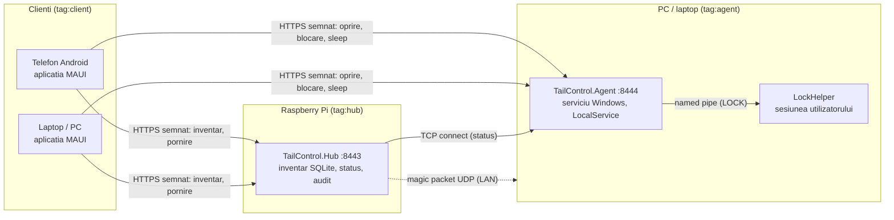

# TailControl

Control la distanta al propriilor dispozitive (**pornire prin Wake-on-LAN, oprire, blocare, sleep** si status online/offline) dintr-o aplicatie .NET MAUI pe **Android si Windows**. Comunicatia trece doar prin **Tailscale**, iar un **Raspberry Pi** face pe hub si pe „trezitor”.

Scenariul principal: am uitat PC-ul pornit si vreau sa-l opresc de pe telefon, fara terminal sau SSH. Sau vreau sa-l pornesc de oriunde ca sa ma conectez la el.

> Proiectul e si o demonstratie de networking si securitate: semnaturi ECDSA per client, anti-replay, zero executie arbitrara, drepturi minime, ACL-uri Tailscale, CI/CD cu artefacte verificabile.

## Arhitectura



- **Agent** (Windows): serviciu ASP.NET Core minimal care executa doar comenzile din lista fixa. Blocarea sesiunii trece printr-un helper din sesiunea utilizatorului, pentru ca un serviciu din Session 0 nu o poate bloca direct.
- **Hub** (Raspberry Pi 3B, linux-arm, langa Pi-hole): inventarul dispozitivelor, Wake-on-LAN, statusul la fiecare 15 s, auditul. **Nu** transmite comenzile de oprire mai departe: acelea merg direct de la client la agent.
- **Client** (MAUI): lista cu status, comenzi cu confirmare (amprenta/PIN pentru oprire si sleep), pairing prin cheie publica si cod QR.

## Securitate pe scurt

| Strat | Cum |
|---|---|
| Retea | Asculta **doar** pe adresele Tailscale; regula de firewall doar din 100.64.0.0/10; ACL cu tag-uri; nimic public |
| Identitate | Fiecare client are cheia lui **ECDSA P-256**. Cheia privata ramane in Android Keystore / DPAPI. Fiecare client poate fi revocat individual. |
| Cereri | Semnatura peste metoda, host, path, timestamp, nonce si hash-ul body-ului; ±30 s; nonce unic; host verificat; backoff si rate limiting |
| Executie | **Lista fixa de comenzi** (`enum`). Singurul proces extern e `shutdown.exe`, cu cale absoluta si argumente constante. Exista teste care o demonstreaza, inclusiv prin scanarea codului sursa. |
| Drepturi | Agentul ruleaza ca LocalService, cu privilegii restranse. Hub-ul are utilizator dedicat si restrictii systemd (scor 1.5). Lista de chei nu poate fi scrisa de servicii. |
| Audit | Cine, ce, cand si rezultatul, pe agent (JSON Lines) si pe Hub (SQLite) |

Detalii in [docs/threat-model.md](docs/threat-model.md) si [docs/protocol-semnare.md](docs/protocol-semnare.md).

## Instalare

Ordinea si toti pasii manuali (BIOS, Tailscale, ACL, instalari, pairing, verificare) sunt in **[docs/setup-checklist.md](docs/setup-checklist.md)**. Artefactele se descarca din **GitHub Releases** si se verifica cu `SHA256SUMS.txt`.

| Componenta | Artefact | Ghid |
|---|---|---|
| Hub (Raspberry Pi) | `tailcontrol-hub-linux-arm.tar.gz` | [docs/hub.md](docs/hub.md) |
| Agent (PC/laptop) | `TailControl-Agent-Setup-<v>.exe` | [docs/agent.md](docs/agent.md) |
| Aplicatie Windows | `TailControl-Client-Setup-<v>.exe` | [docs/client.md](docs/client.md) |
| Aplicatie Android 11+ | `TailControl-<v>.apk` | [docs/client.md](docs/client.md) |

## Structura

| Proiect | Rol |
|---|---|
| `src/TailControl.Shared` | Contracte (DTO), lista de comenzi, protocolul de semnare, validari |
| `src/TailControl.Shared.AspNetCore` | Middleware de verificare a semnaturilor, hosting pe Tailscale, CLI de autorizare (comune Agent/Hub) |
| `src/TailControl.Agent` | Serviciul Windows (port 8444) |
| `src/TailControl.LockHelper` | Helper-ul de blocare din sesiunea utilizatorului |
| `src/TailControl.Hub` | API-ul de pe Raspberry Pi (port 8443) |
| `src/TailControl.Client.Core` | Logica clientului, fara MAUI: API semnat, setari, identitate |
| `src/TailControl.Client` | Aplicatia .NET MAUI (Android + Windows) |
| `tests/TailControl.Tests` | Teste xUnit, inclusiv end-to-end prin Hub si Agent reale, in memorie |
| `deploy/` | Installere Inno Setup, pachetul si unitatile systemd pentru Pi, build-ul APK |
| `tools/SqliteSmoke` | Testul de fezabilitate SQLite pe ARM32 (etapa 0) |

## Build si teste

Cerinte: .NET SDK 10 (vezi `global.json`) si workload-urile `maui-android` + `maui-windows`, pentru client. Testele ruleaza pe Windows.

```bash
dotnet build TailControl.slnx
```

```bash
dotnet test tests/TailControl.Tests
```

Agentul si Hub-ul pornesc local in modul de dezvoltare: asculta doar pe loopback, iar agentul ruleaza in **DryRun**, adica nu executa nimic.

```bash
dotnet run --project src/TailControl.Agent
```

CI, release-uri, keystore-ul Android si alegerea Inno Setup sunt descrise in [docs/release.md](docs/release.md).

## Documentatie

- [Checklist de instalare](docs/setup-checklist.md)
- [Model de amenintare](docs/threat-model.md)
- [Protocolul de semnare](docs/protocol-semnare.md)
- [Exemplu de ACL Tailscale](docs/tailscale-acl.example.hujson)
- [Agentul Windows](docs/agent.md) · [Hub-ul](docs/hub.md) · [Aplicatia](docs/client.md)
- [Release si CI/CD](docs/release.md) · [Politica de securitate](SECURITY.md)

## In afara v1

Restart, hibernate, comenzi configurabile (`commands.json`), transfer de fisiere, control de ecran, iOS si notificari nu fac parte din v1. Pentru ecran si fisiere se foloseste AnyDesk.
